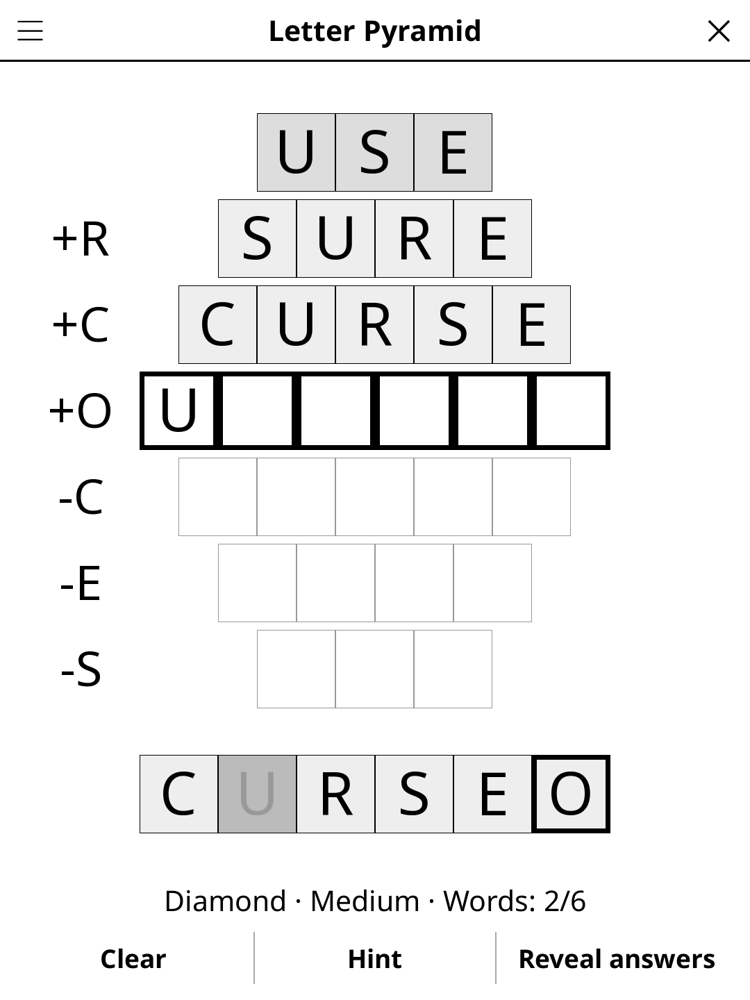

# letterpyramid.koplugin

A Letter Pyramid word puzzle for [KOReader](https://github.com/koreader/koreader):
every row is a word one letter longer than the row above it.

## Screenshot

## Rules

The first row is given. Each row below it adds one letter to the row above
(+E, shown on the left) and the letters may be rearranged: CAT + R gives
CART, and ACT + R gives CART too. Fill every row to complete the pyramid.

Any real word made of the row's letters is accepted, not only the one the
puzzle was built with, so no row ever asks you to guess which word was meant.

## Modes

- **Pyramid** — from a 3-letter word down to the longest one, one letter
  added per row.
- **Upside down** — from a long word to a 3-letter one, one letter taken
  away per row (−E).
- **Diamond** — up to a long word, then back down to a different 3-letter
  word.

## Features

- **English and French** — follows KOReader's language by default,
  switchable from the menu. French accents are ignored (É is typed E).
- **Three levels**, measured on the generator's output:

  | Level | Pyramid / Upside down | Diamond | Words |
  |---|---|---|---|
  | Easy | 3 → 6 letters, 4 rows | peak 5, 5 rows | everyday words; about 2 rows in 3 just take the letter in |
  | Medium | 3 → 7 letters, 5 rows | peak 6, 7 rows | everyday words |
  | Hard | 3 → 9 letters, 7 rows | peak 7, 9 rows | rarer words; about 3 rows in 4 need the letters rearranged |

- **Tiles that start from the word above** — the row being filled offers the
  letters of the word above it plus the new one, so you rearrange rather than
  hunt. Tap a tile to place it, tap a placed letter to give it back; the word
  is checked as soon as the row is full.
- **Any order** — tap a row to work on it; stuck on one, try the next.
- **Hint** — the first tap gives a word's first letter, the second fills
  the row.
- **Reveal answers** — ends the puzzle and shows the rows left empty.
- **Daily Challenge** — the same pyramid for everyone, all day (Medium
  pyramid, in each language).
- **Family-friendly** — the words a puzzle shows never include vulgar words.
- **Auto-save** — the current puzzle is restored on next launch.

## Word lists

Built by `tools/build_words.py` from the dictionaries of
[boggle.koplugin](https://github.com/t2ym5u/boggle.koplugin) (ENABLE, Public
Domain; a CC0 Scrabble-valid French list and an-array-of-french-words, MIT).
The pyramids use only common words (the top 30,000 of the OpenSubtitles
frequency lists, hermitdave/FrequencyWords, CC-BY-SA 4.0; top 15,000 for Easy
and Medium); the rest of the dictionary is accepted when typed, in French
including the forms of the [Grammalecte](https://grammalecte.net) lexicon
(Dicollecte, MPL 2.0) that Boggle's list carries.

## Installation

1. Download `letterpyramid.koplugin.zip` from the [latest release](../../releases/latest).
2. Extract into the `plugins/` folder of your KOReader data directory.
3. Restart KOReader.
4. Open the menu → **Tools** → **Games** → **Word games** → **Letter Pyramid**.

## License

GPL-3.0 — see [LICENSE](LICENSE).
